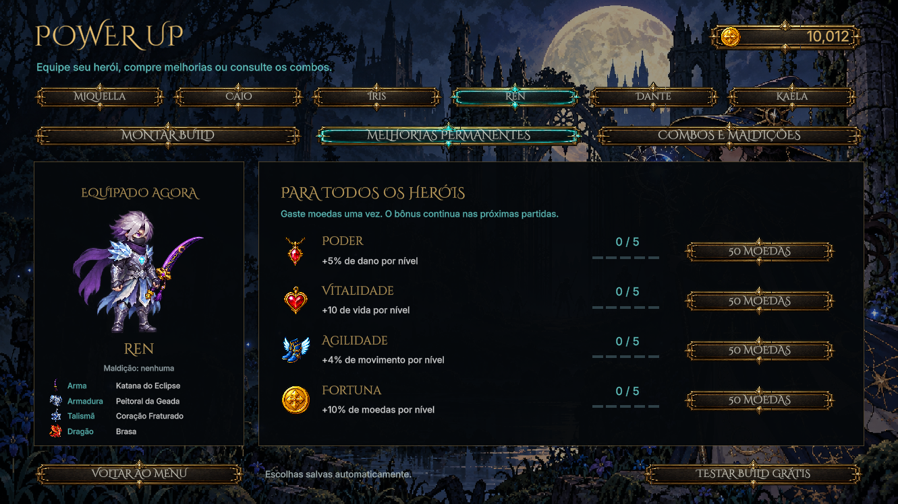
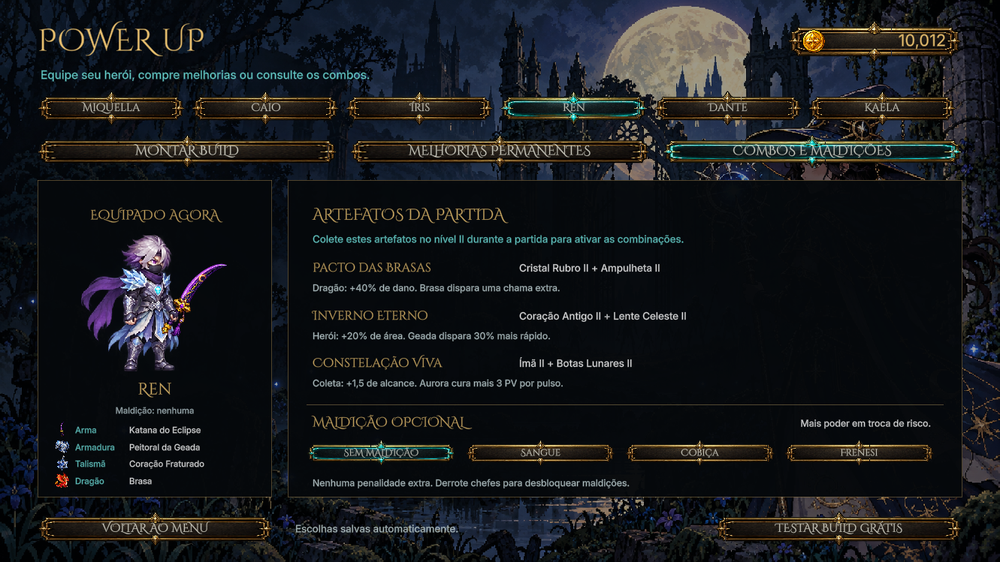

# Versão 0.30.0

Checkpoint da versão atual com o Power Up reorganizado e a fonte Cinzel Decorative aprovada para os menus.

## Alterações mais recentes

- Três áreas claras no Power Up: Montar build, Melhorias permanentes e Combos e maldições.
- Equipamento direto na mesma tela, com prévia do personagem e resumo sempre visíveis.
- Cartões distintos para itens equipados, disponíveis e bloqueados; descrição do requisito de desbloqueio.
- Escolha de arma, armadura, talismã e dragão; possibilidade de remover os três últimos.
- Maldição ativa visível no resumo e acesso ao treino gratuito.
- Menus com Cinzel Decorative, textos de apoio legíveis e enquadramento revisado.
- Armas visíveis na mão do herói nas prévias dos menus.

## Evidências de verificação

Relatórios locais preservados com suas datas originais:

- [Power Up organizado](Verificacoes/VERIFICACAO-POWER-UP.txt): troca direta, bloqueios, isolamento por herói, compras e retorno ao menu/preparação.
- [Menus e fontes](Verificacoes/VERIFICACAO-MENU.txt): acentos, ajuste dos rótulos, limites do canvas e navegação.
- [Armas e armaduras](Verificacoes/VERIFICACAO-EQUIPAMENTOS.txt): combinações de equipamentos, empunhaduras e visual 2.5D.
- [Campanha e resgates](Verificacoes/VERIFICACAO-FASES.txt): sequência dos quatro mapas e preservação da build.

A versão 0.30 também teve conferência visual e troca de arma pelo menu dentro da Unity. Os relatórios registram o escopo de cada verificação; não substituem playtests com jogadores.

## Prévia

