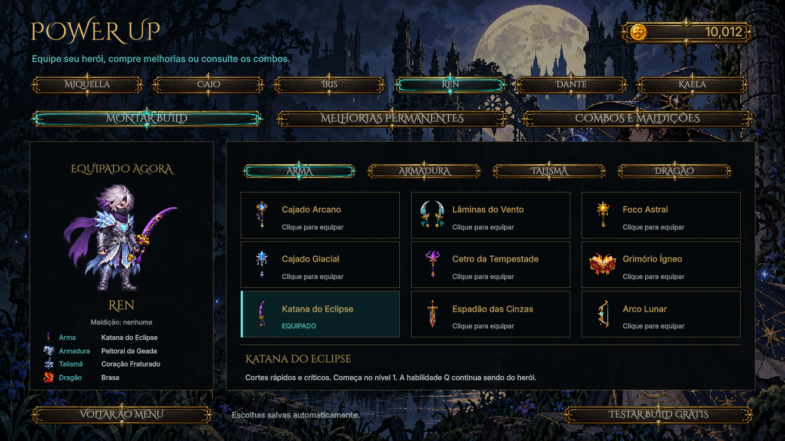

# Miquella's: Nightfall Survivor

**Versão 0.30.0** — projeto Unity completo da versão atual de teste.

Jogo de sobrevivência com campanha em quatro mapas, seis heróis, armas intercambiáveis, armaduras visuais, dragões companheiros e combinações de artefatos.

## Abrir na Unity

1. Use a **Unity 6.3 LTS — 6000.3.22f1**.
2. No Unity Hub, escolha **Add / Adicionar projeto** e selecione esta pasta, que contém `Assets`, `Packages` e `ProjectSettings`.
3. Abra `Assets/Scenes/NoiteSemFim.unity` e pressione **Play**.

O nome interno da cena e o namespace `NoiteSemFim` foram mantidos para preservar as referências do projeto.

## Teste com conteúdo liberado

No menu superior do editor, use **Miquella's: Nightfall Survivor > Abrir versão completa para teste**. Esse modo usa um perfil separado com personagens e equipamentos desbloqueados e moedas para testar.

Para usar o progresso normal, pare o Play e use **Usar progresso normal (fora do Play)**. O perfil salvo na máquina não é incluído no repositório.

## Power Up da versão 0.30

- **Montar build:** escolha o herói e equipe arma, armadura, talismã e dragão na própria tela. O visual e o resumo do equipamento ficam à esquerda.
- **Melhorias permanentes:** compras com moedas que valem para todos os heróis nas próximas partidas.
- **Combos e maldições:** consulte as receitas dos artefatos coletados durante a partida e escolha uma maldição inicial opcional.
- **Testar build grátis:** abre o treino para testar combinações sem gastar moedas do progresso normal.

Itens bloqueados mostram o requisito de desbloqueio. Dragões são liberados por missões; armaduras e talismãs são obtidos dos chefes.

## Campanha

**Bosque das Cinzas → Necrópole Lunar → Forja Esquecida → Arena do Eclipse em 2.5D.**

Os três primeiros mapas terminam com chefe e resgate. A campanha continua até o confronto final com o Soberano do Eclipse, preservando a build entre fases.

## Controles

| Ação | Controle |
| --- | --- |
| Mover | WASD / setas |
| Esquiva | Espaço |
| Habilidade do herói | Q |
| Mirar e atacar no modo manual | Mouse / botão esquerdo |
| Pausar ou voltar | Esc |
| Som ligado/desligado | M |

A mira automática ou manual é escolhida em **Opções**.

## Conteúdo incluído

- Código C#, cena, prefabs, imagens, animações, modelos, áudio e fontes.
- Configurações da Unity e dependências em `Packages`.
- [Resumo da versão e verificações](Docs/VERSAO-0.30.md).
- [Licença da Cinzel Decorative](Assets/Resources/Fonts/CinzelDecorative-OFL.txt) e [licença da fonte de leitura derivada de Inter](Assets/Resources/Fonts/Inter-OFL.txt).

As pastas `Library`, `Temp`, `Logs`, `UserSettings` e aplicativos compilados não são versionadas. A Unity recria os arquivos locais ao importar o projeto.

OBS!!:
(A gente concentrou o projeto em um unico pc para fazer os commits e a interface dentro do jogo foram arrumadas)
